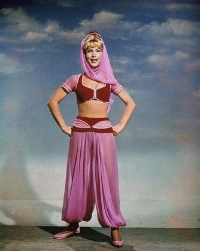

A five-hour shift today. Five hours can feel longer than six, because you only get one ten-minute break. It was a steady day, but a few guests turned it into a day of stories.

An older couple, maybe in their sixties, were looking at our pant wall when I went over to say hi. The lady loved one style, and her husband laughed and said it looked just like the pants Jeannie wore in the old sitcom *I Dream of Jeannie*. I looked it up right away, and he was right. It was our foldover jogger: the same soft, full leg, gathered at the ankle.

<figure class="post-fig"><figcaption>Barbara Eden as Jeannie in <em>I Dream of Jeannie</em> (NBC, 1965–1970)</figcaption></figure>

A costume from a 1960s TV show, and almost sixty years later the same shape is hanging on our wall. Fashion really does come back around. It made me wonder how many of the "new" silhouettes we sell are really old stories, told again.

Later, another older couple came in. When I asked what brought them in, the man smiled and said, "Just to see you." I had no idea what to say! They were looking for a carry-on bag. I showed them a tote and a ruched bag, but in the end they found a gym bag on their own, and it was exactly right. I kept thinking, why didn't I show them that one first? Moments like that remind me that knowing the product well is how you make someone's day easier. Next time, I want to know the bag wall well enough to find the perfect one first.
