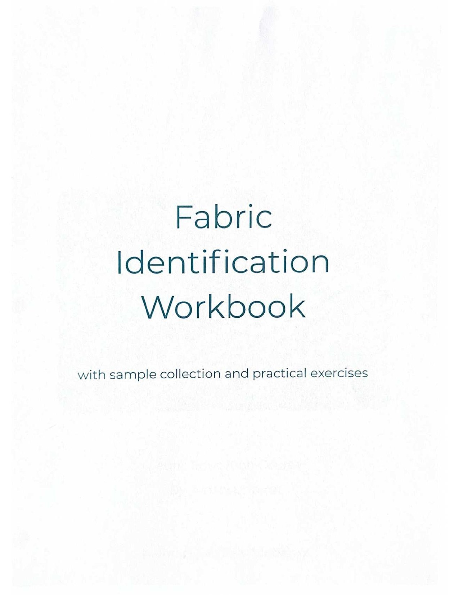
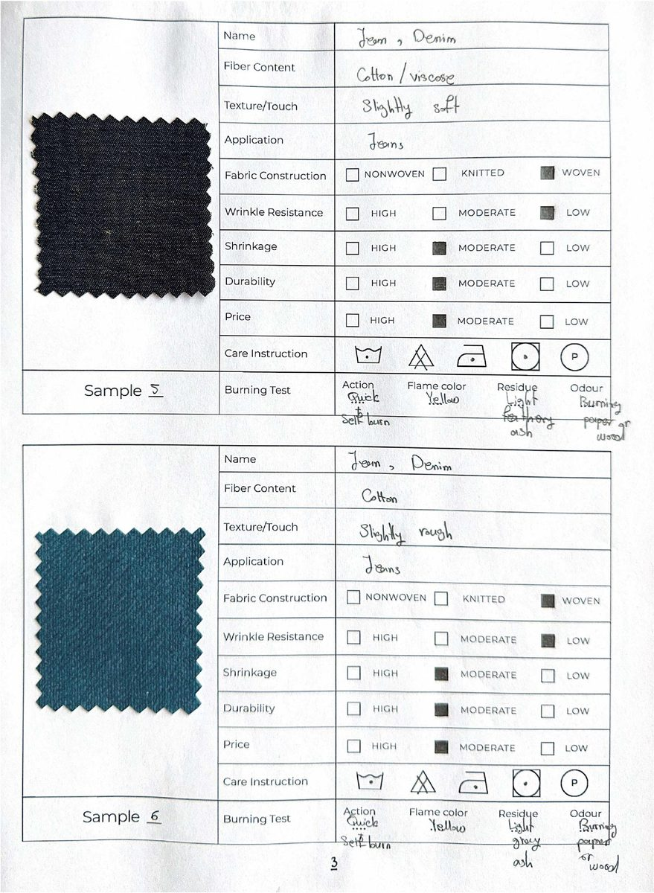
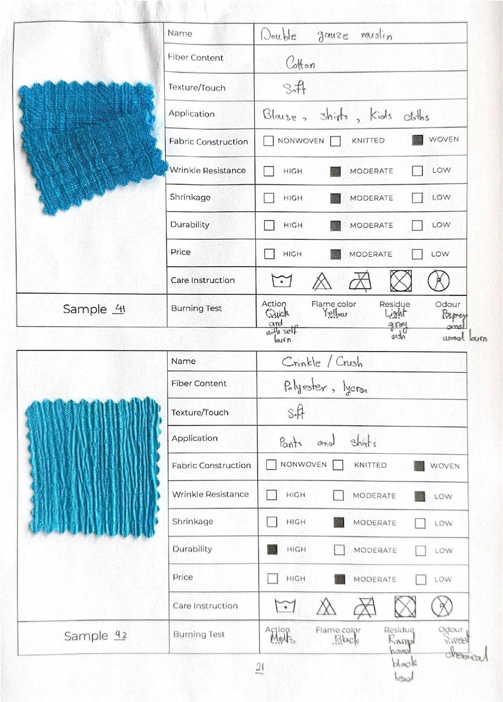
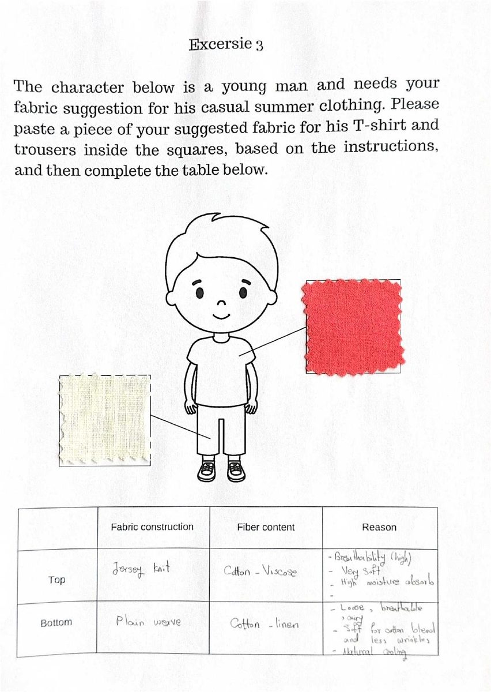

<a href="/projects/">Projects</a> / Design and craft · Mehrazi Fashion School · 2025

In 2025, I spent two months in a textile course at Mehrazi Fashion School in Tehran, taught by Masood Talari.

Fabric decides how a garment fits, feels and lasts, so I wanted to understand it properly, not just by touch. And honestly, growing up I always found fabric shops more exciting than amusement parks, so maybe this path was inevitable.

We looked at fabric from many different angles. The parts that stayed with me most:

- **Around 70 fabric samples**, from natural fibres to man-made textiles, reviewed and analyzed one by one.
- **The burn test:** telling cotton from wool by the smell and the ash.
- **Fibre length:** how staple and filament fibres change the twist of a yarn.
- **Some of the world's finest cottons**, like Sea Island.
- **Plant-based fibres** like banana, which may play a bigger role in the future.
- **Many fabrics, one job:** how different fabrics can serve the same purpose, and how many options we really have for any single use.
- **Weaves**, like plain and twill, and how tricky it can be to tell the right side from the wrong side of some fabrics.
- **Shrinkage**, measured with hands-on tests.
- **Where pilling comes from.**
- **GSM** (grams per square metre), for comparing fabric weights.
- **Care labels**, and finally understanding those small symbols we see every day.

The result is a personal swatch book of about 70 samples: my first dictionary of textiles.

  <figure></figure>
  <figure></figure>
  <figure></figure>
  <figure></figure>

<a href="/assets/Fabric_Identification_Workbook.pdf" target="_blank" rel="noopener">See the full workbook (PDF, 45 pages) →</a>

Today, on the store floor, it changes how I talk about product. When a guest asks why one fabric feels the way it does, or why another one pills, I can actually answer.
